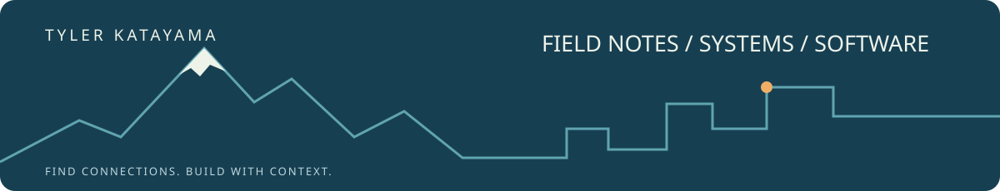

  

# From mechanical rooms to software

I've spent over a decade working with physical systems, troubleshooting failures, and learning what happens when the tools we're given don't solve the problems in front of us.

That curiosity eventually took me beyond mechanical equipment and into software, where I began exploring how the same principles of observation, diagnostics, and problem-solving apply.

I find connections, seek balance, and pursue integrity. I'm interested in understanding how things work, why they fail, and how we can improve them.

I'm still learning, still building, and sharing what I discover along the way.

**[Start with FEOS](https://facilities-evidence-os.vercel.app/)** · **[The rest of my world](https://linktr.ee/themountainshinobi)** · **Let's connect**

[Start with FEOS](https://facilities-evidence-os.vercel.app/) · [The rest of my world](https://linktr.ee/themountainshinobi) · [Let's connect](mailto:tylerkat89@gmail.com)

## Selected work

### 01 / Facilities Evidence OS
**Personal · independent product · active development / founding pilot**

The building is the interface. I'm building a map-first workspace that keeps issues, vendors, photo evidence, inventory, and budgets attached to the place they belong. It comes directly from the work I know: walking a property, finding the problem, and making sure the next person has the context.

[Explore FEOS](https://facilities-evidence-os.vercel.app/) · [Read the project](https://github.com/tylerkat89/facilities-evidence-os)

### 02 / SF Stairs
**WeAreDevelopers · Entire workshop · learning fork**

A San Francisco stairway field guide with mapping, source attribution, and a clear distinction between surveyed counts and estimates. My copy comes from the Entire workshop and retains the upstream project's work and credits. I'm using it to study how a map earns trust in its data; I don't claim the inherited implementation as my own.

[Explore the repository](https://github.com/tylerkat89/sf-stairs-map) · [Original project](https://github.com/elizabethsiegle/sf-stairs-map)

### 03 / Husband vs Contractor 🔧
**Handshake AI Skills Studio · multiplayer game challenge · playable prototype**

One device, two players, and a DIY budget that confidence cannot fix. A browser game about inspecting the clues, choosing the right order, and knowing when to call the pro. My facilities background meets a Marriage Meter.

[Play a round](https://tylerkat89.github.io/husband-vs-contractor/) · [Read the design](https://github.com/tylerkat89/husband-vs-contractor/blob/main/DESIGN.md)

## School / Fullerton College

Computer Information Systems, including Python / CIS 201. Formal study adds to the field experience I bring to software.

## Workshops / learning in progress

**WeAreDevelopers — Entire workshop:** [workshop.01](https://github.com/tylerkat89/workshop.01) is a reserved workshop repository; implementation hasn't started. SF Stairs above is the workshop learning fork.

## Experiments can have a sense of humor

**[Haunted Handshake](https://haunted-handshake-terminal.tylerkat89.chatgpt.site/)** — a creative terminal-animation experiment, made with ChatGPT + Codex. A Handshake logo reconstructed from code, with a little haunted-arcade energy.

## Currently exploring

Map-first interfaces, reliable data imports, browser-based tools, and how to carry useful context from the field into software. I use AI-assisted workflows, then inspect what they produce and keep the limits visible.

Open to school-compatible work in IT support, QA, data, software, or facilities operations.

Project context: this is my personal portfolio. Each project identifies its own origin and development state; workshop participation is not a claim of sponsorship or endorsement.
