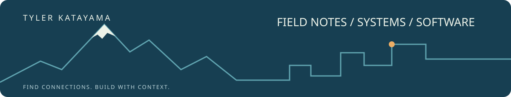

  

# From mechanical rooms to software

**Project creator and maintainer: [Tyler Katayama](https://github.com/tylerkat89) · [Attribution](ATTRIBUTION.md)**

I've spent over a decade working with physical systems, troubleshooting failures, and learning what happens when the tools we're given don't solve the problems in front of us.

That curiosity took me into software. I had a problem. I wanted to understand it. Then I started building ways to fix it.

That's how I want to share my work here: what got in the way, what I tried, what broke, and what finally helped. The code matters. So do the decisions and the obstacles behind it.

I use AI-assisted workflows, bring the questions from my field experience, and check the results. I'm still learning, still building, and documenting what holds up.

[Start with Layout Square](./projects/layout-square/README.md) · [The rest of my world](https://linktr.ee/themountainshinobi) · [Let's connect](mailto:tylerkat89@gmail.com)

## Selected work

### 01 / Layout Square
**Personal · AI-assisted development · local release candidate**

I wanted a design in a job photo to carry through to the materials and costs behind it. Getting there meant solving more than the drawing: measured geometry had to produce usable purchase quantities, design changes had to preserve old material connections, and new prices had to leave historical costs alone.

The photo editor and job portal each had working pieces the other needed. Bringing them together exposed migration problems, temporary saves, and a pricing bug that earlier mocks missed. The resulting local package connects design, material requirements, and inventory accounting—with the remaining field and live-pricing checks documented.

[Read the story: the drawing had to survive the rest of the job](./projects/layout-square/README.md)

### 02 / Facilities Evidence OS
**Personal · independent product · active development / founding pilot**

The building is the interface. I'm building a map-first workspace that keeps issues, vendors, photo evidence, inventory, and budgets attached to the place they belong. It comes directly from the work I know: walking a property, finding the problem, and making sure the next person has the context.

[Explore FEOS](https://facilities-evidence-os.vercel.app/) · [Read the project](https://github.com/tylerkat89/facilities-evidence-os-showcase)

### 03 / Watchpost
**Personal · video monitoring and recording · privately maintained source**

Watchpost brings camera feeds and compatible public streams into one browser-based monitoring workflow. It combines motion detection, local recording, and passcode-protected live viewing with a record of stream interruptions, timing changes, and continuity issues. Exportable logs and per-clip metadata keep the recording connected to what the application observed.

[Explore Watchpost](./projects/watchpost/README.md)

### 04 / QA Evidence Gate
**Personal · QA process design · v0.1 concept**

A protocol for keeping QA findings, evidence, and human decisions traceable when working with AI agents. Built from an audit of a real QA exercise, it separates observations from expectations, checks claims against artifacts, and preserves the reasoning behind corrections. The protocol is documented; its gates remain provisional while validation is in progress.

[Read the protocol](https://github.com/tylerkat89/qa-evidence-gate)

### 05 / SF Stairs
**WeAreDevelopers · Entire workshop · learning fork**

A San Francisco stairway field guide with mapping, source attribution, and a clear distinction between surveyed counts and estimates. My copy comes from the Entire workshop and retains the upstream project's work and credits. I'm using it to study how a map earns trust in its data; I don't claim the inherited implementation as my own.

[Explore the repository](https://github.com/tylerkat89/sf-stairs-map) · [Original project](https://github.com/elizabethsiegle/sf-stairs-map)

### 06 / Husband vs Contractor 🔧
**Handshake AI Skills Studio · multiplayer game challenge · playable prototype**

One device, two players, and a DIY budget that confidence cannot fix. A browser game about inspecting the clues, choosing the right order, and knowing when to call the pro. My facilities background meets a Marriage Meter.

[Play a round](https://tylerkat89.github.io/husband-vs-contractor/) · [Read the design](https://github.com/tylerkat89/husband-vs-contractor/blob/main/DESIGN.md)

## School / Fullerton College

Computer Information Systems, including Python / CIS 201. Formal study adds to the field experience I bring to software.

## Workshops / learning in progress

**WeAreDevelopers — Entire workshop:** SF Stairs above is the workshop learning fork.

## Experiments can have a sense of humor

**[Haunted Handshake](https://haunted-handshake-terminal.tylerkat89.chatgpt.site/)** — a creative terminal-animation experiment, made with ChatGPT + Codex. A Handshake logo reconstructed from code, with a little haunted-arcade energy.

## Currently exploring

Map-first interfaces, reliable data imports, browser-based tools, and how to carry useful context from the field into software. I use AI-assisted workflows, then inspect what they produce and keep the limits visible.

Open to school-compatible work in IT support, QA, data, software, or facilities operations.

Project context: this is my personal portfolio. Each project identifies its own origin and development state; workshop participation is not a claim of sponsorship or endorsement.
