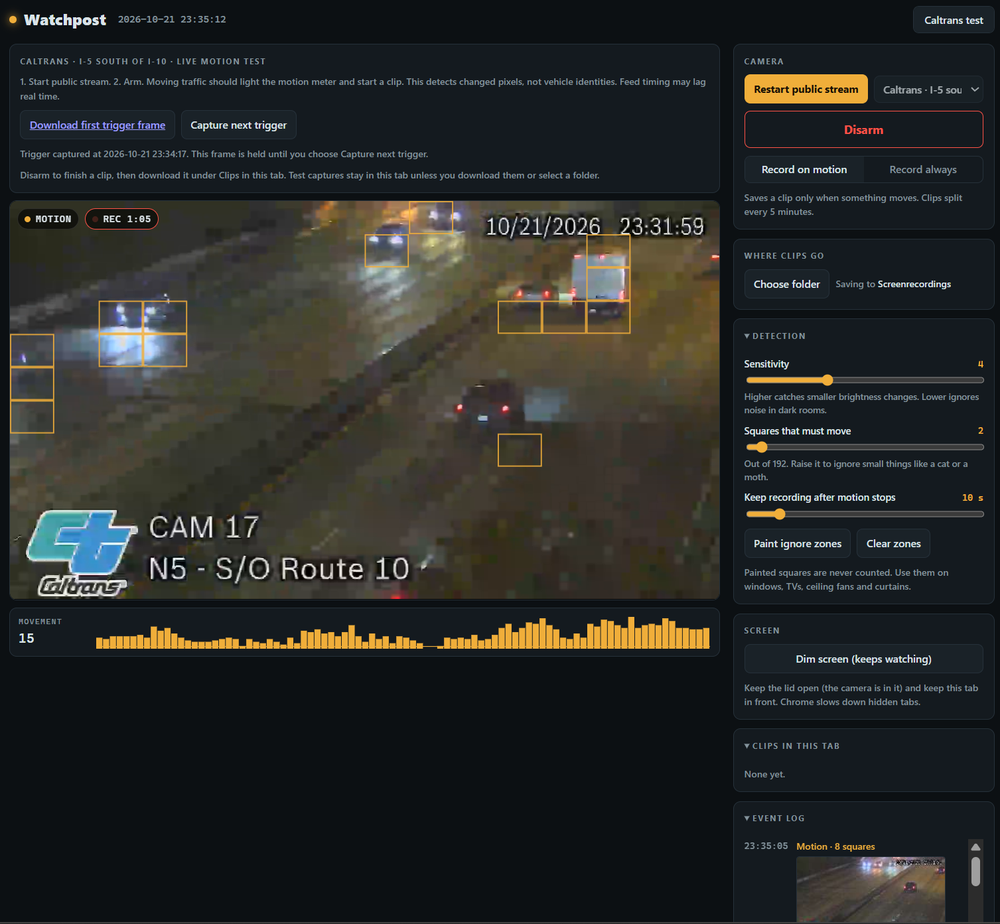
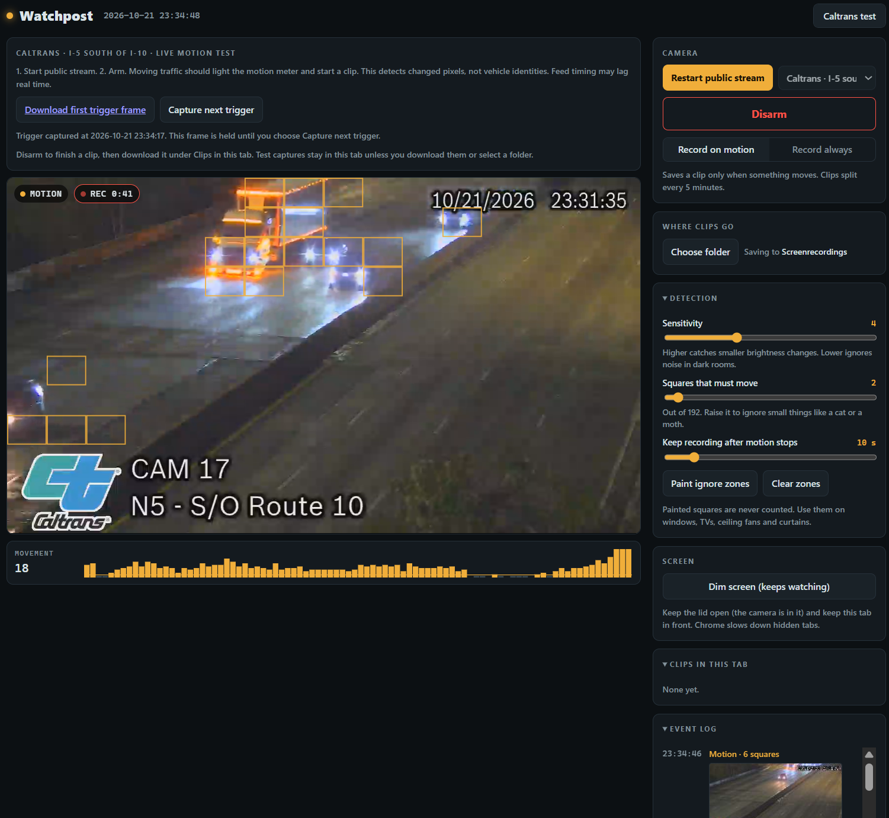
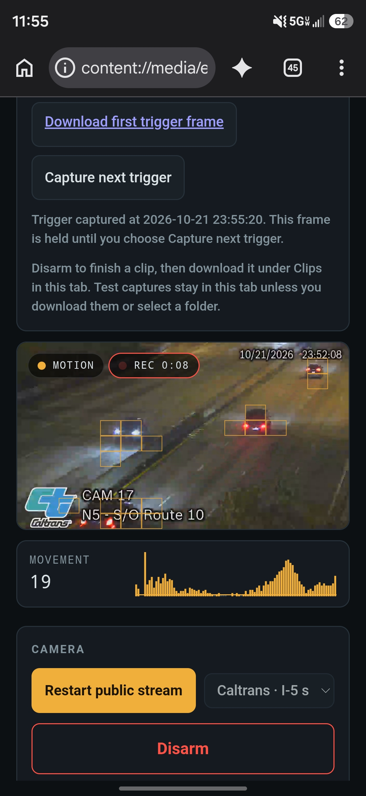

# Watchpost

### Video monitoring, motion detection, and remote administration in the browser.

Watchpost is a browser-based video monitoring and recording system. It combines configurable motion detection, timestamped local recordings, authenticated live viewing, and separately authorized remote administration in one compact application. Built for camera-based monitoring, it has also demonstrated motion detection and recording from a public live video feed on desktop and mobile.

The camera does the work. It compares changes across a configurable motion grid, records when activity crosses the selected threshold, and keeps recording for a chosen interval after movement stops. Sensitivity and ignore zones let the operator tune detection to the scene. Continuous recording is available too, with five-minute clip segmentation and local folder storage.

Remote access builds on the same application. WebRTC carries live video and control messages, while separate viewer and owner permissions keep watching separate from managing the camera. Administration must be enabled on the recording device. Requested settings are validated there, and the remote interface waits for the camera to confirm the change.

The interface keeps the camera image central, with amber motion indicators, recording status, and grouped controls that adapt to desktop and phone screens. Connection recovery and visible storage errors are part of the design, because a recorder needs to remain useful when remote viewing fails.

Watchpost combines browser media APIs, canvas-based motion analysis, local recording, and authenticated peer communication in a portable single-file application. The screenshots come from a live public-feed demonstration on desktop and mobile. Traffic imagery: Caltrans, I-5 south of I-10, Camera 17. No affiliation or endorsement is implied.

The current build has passed 34 isolated checks and 18 controlled Chrome scenarios. Long unattended Chromebook operation, remote access across the intended networks, and off-device backup still require field validation.

**Source is privately maintained.** This showcase shares the project and its interface without distributing the application.
